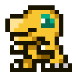
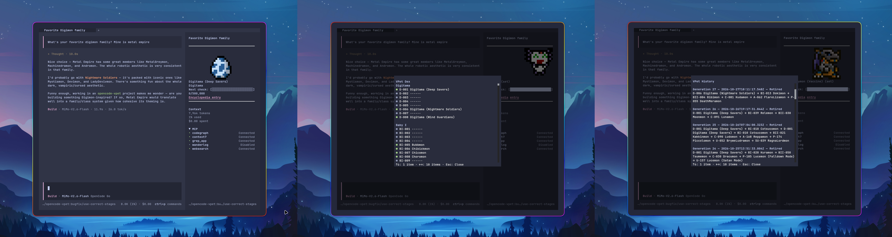

<div align="center">
  
  <h1>opencode-vpet</h1>
  <p>
    A Digimon virtual pet for OpenCode that evolves with usage.
  </p>
  <p>
    <a href="#about">About</a> | 
    <a href="#evolution">Evolution</a> | 
    <a href="#quick-start">Quick start</a> | 
    <a href="#commands">Commands</a> | 
    <a href="#settings">Settings</a> | 
    <a href="#storage">Storage</a> | 
    <a href="#partner-list">Partner list</a> |
    <a href="#license">License</a> |
    <a href="#attributions">Attributions</a>

  </p>
</div>

---

## About

<div align="center">
  
</div>

`@sbugallo/opencode-vpet` is an OpenCode v2 plugin that adds a Digimon virtual pet to your OpenCode TUI 
sidebar. Your Digimon evolves as you use OpenCode, and you can browse your discoveries and 
partner history.

The plugin support multiple concurrent sessions, so every token counts to evolve your partner.

There are more than 1,100 Digimon to discover, and the plugin is designed to be extensible so that new Digimon can be added in future releases.

## Evolution

Your active partner gains experience from the tokens reported for completed assistant
messages in OpenCode. This includes input, output, reasoning, and cache tokens.
Progress is shared across concurrent OpenCode sessions, so completed work in each
session contributes to the same partner.

Each stage has a configurable experience threshold. When your partner reaches the
threshold for its current stage, it evolves and its experience gauge resets for the
next stage. Use `/vpet-freeze` to pause partner progression; usage while frozen is
not applied to your partner.

The bundled evolution lines were extracted from the original V-Pets. When a Digimon
reaches an evolution threshold, the plugin randomly chooses one of the evolution
options in that Digimon's line.

## Quick start

Requirements:
- OpenCode `>=2.0.18`
- Node `>=20` to run `npx`
- Bun `>=1.3.5` only for local development


1. Install both plugins:

   ```sh
   npx @sbugallo/opencode-vpet init
   ```

   The CLI delegates to `opencode plugin add @sbugallo/opencode-vpet@<installed-package-version>`.
   It uses the package's installed exact version so OpenCode uses a version-specific cache key rather
   than reusing a stale bare or `@latest` cache entry.

2. Restart OpenCode when the command finishes.

3. In OpenCode, run `/vpet-spawn` to hatch a partner.

After that, use `/vpet-dex` to browse discoveries and `/vpet-history` to browse current and retired generations.

---

## Commands

| Command | Description |
| --- | --- |
| `/vpet-spawn` | Spawns a random Digiegg. |
| `/vpet-spawn-<field>` | Spawns a Digiegg of one Digitama field (`deep-savers`, `dragons-roar`, `jungle-troopers`, `metal-empire`, `nature-spirits`, `nightmare-soldiers`, `virus-busters`, `wind-guardians`). |
| `/vpet-freeze` | Pauses partner progression. |
| `/vpet-unfreeze` | Resumes partner progression. |
| `/vpet-set <id>` | Overrides the partner with the specified catalog ID. |
| `/vpet-dex` | Opens the partner Dex. |
| `/vpet-history` | Opens the partner History. |

> [!NOTE]
> Using `/vpet-set` does not count for dex completion.

## Update

To update the plugin, run:

```sh
npx @sbugallo/opencode-vpet update
```

Like `init`, `update` delegates to OpenCode's native global plugin installer with the installed exact
package version. If a legacy unscoped `opencode-vpet` registration is present, remove it manually.

## Settings

Settings are stored in `opencode-vpet.json` and control naming, notifications, and evolution
thresholds.

The location of the settings file depends on your operating system:

- Linux, WSL, and macOS: `~/.config/opencode-vpet.json`
- Windows: `%APPDATA%\opencode-vpet.json`, or `%USERPROFILE%\AppData\Roaming\opencode-vpet.json`
  when `APPDATA` isn't set.


Available settings are:

| Setting | Description |
| --- | --- |
| `notifications` | Enables or disables notifications. |
| `language` | Sets the naming convention. Valid values are `jp` (Japanese, e.g., Omegamon, Child, Adult...) and `en` (English, e.g., Omnimon, Rookie, Champion...). |
| `stageThresholds` | Defines the experience thresholds for each evolution stage. |

Default values are:

```json
{
  "notifications": true,
  "language": "jp",
  "stageThresholds": {
    "egg": 500000,
    "babyI": 1000000,
    "babyII": 2000000,
    "child": 4000000,
    "adult": 7500000,
    "perfect": 12500000,
    "ultimate": 20000000,
    "superUltimate": 30000000
  }
}
```

## Storage

To persist your partner, history, and control state, VPet uses a SQLite database named `pet.db`. The location of the database depends on your operating system:

- Linux, WSL: `~/.local/share/opencode-vpet/pet.db`
- macOS: `~/Library/Application Support/opencode-vpet/pet.db`
- Windows: `%APPDATA%\opencode-vpet\pet.db`, or `%USERPROFILE%\AppData\Roaming\opencode-vpet\pet.db` 
  when `APPDATA` isn't set.

---

## Partner list

| ID | Japanese name | English name |
| --- | --- | --- |
| D-001 | Digitama (Deep Savers) | Digiegg (Deep Savers) |
| D-002 | Digitama (Dragon's Roar) | Digiegg (Dragon's Roar) |
| D-003 | Digitama (Jungle Troopers) | Digiegg (Jungle Troopers) |
| D-004 | Digitama (Metal Empire) | Digiegg (Metal Empire) |
| D-005 | Digitama (Nature Spirits) | Digiegg (Nature Spirits) |
| D-006 | Digitama (Nightmare Soldiers) | Digiegg (Nightmare Soldiers) |
| D-007 | Digitama (Virus Busters) | Digiegg (Virus Busters) |
| D-008 | Digitama (Wind Guardians) | Digiegg (Wind Guardians) |
| BI-001 | Algomon | Argomon |
| BI-002 | BOMMON | Bommon |
| BI-003 | Bombmon | Bommon (2010 Anime Version) |
| BI-004 | Botamon | Botamon |
| BI-005 | Bubbmon | Pabumon |
| BI-006 | Chibickmon | Chibickmon |
| BI-007 | Chicomon | Chibomon |
| BI-008 | Choromon | Choromon |
| BI-009 | Cocomon | Conomon |
| BI-010 | Cotsucomon | Cotsucomon |
| BI-011 | CURIMON | Curimon |
| BI-012 | Dodomon | Dodomon |
| BI-013 | Dokimon | Dokimon |
| BI-014 | Fufumon | Fufumon |
| BI-015 | FUKAMON | Fukamon |
| BI-016 | FUSAMON | Fusamon |
| BI-017 | Jyarimon | Jyarimon |
| BI-018 | Kiimon | Keemon |
| BI-019 | Ketomon | Ketomon |
| BI-020 | Kuramon | Kuramon |
| BI-021 | LEAFMON | Leafmon |
| BI-022 | Mokumon | Mokumon |
| BI-023 | Nyokimon | Nyokimon |
| BI-024 | PAFUMON | Pafumon |
| BI-025 | PAOMON | Paomon |
| BI-026 | Petitmon | Petitmon |
| BI-027 | PIPIMON | Pipimon |
| BI-028 | Pitchmon | Pichimon |
| BI-029 | POPOMON | Popomon |
| BI-030 | Poyomon | Poyomon |
| BI-031 | Punimon | Punimon |
| BI-032 | PUPUMON | Pupumon |
| BI-033 | Pururumon | Pururumon |
| BI-034 | PUSUMON | Pusumon |
| BI-035 | Puttimon | Puttimon |
| BI-036 | PUWAMON | Puwamon |
| BI-037 | PUYOMON | Puyomon |
| BI-038 | PYONMON | Pyonmon |
| BI-039 | Relemon | Relemon |
| BI-040 | Sakumon | Sakumon |
| BI-041 | Sunamon | Sandmon |
| BI-042 | TOMORIMON | Tomorimon |
| BI-043 | Tsubumon | Tsubumon |
| BI-044 | YOLKMON | Yolkmon |
| BI-045 | Yukimibotamon | YukimiBotamon |
| BI-046 | Yuramon | Yuramon |
| BI-047 | Zerimon | Zerimon |
| BI-048 | Zurumon | Zurumon |
| BII-001 | Algomon | Argomon |
| BII-002 | Arkadimon Baby | Arcadiamon In-Training |
| BII-003 | Babydmon | Bebydomon |
| BII-004 | Bibimon | Bibimon |
| BII-005 | BOWMON | Bowmon |
| BII-006 | Budmon | Budmon |
| BII-007 | Capromon | Kapurimon |
| BII-008 | CHAPMON | Chapmon |
| BII-009 | Chibimon | DemiVeemon |
| BII-010 | CHICCHIMON | Chicchimon |
| BII-011 | Chocomon | Kokomon |
| BII-012 | CUPIMON | Cupimon |
| BII-013 | Dorimon | Dorimon |
| BII-014 | FLUFFYMON | Fluffymon |
| BII-015 | Gigimon | Gigimon |
| BII-016 | Goromon | Tumblemon |
| BII-017 | Gummymon | Gummymon |
| BII-018 | GURIMON | Gurimon |
| BII-019 | Hiyarimon | Hiyarimon |
| BII-020 | Hopmon | Hopmon |
| BII-021 | Kakkinmon | Kakkinmon |
| BII-022 | Koromon | Koromon |
| BII-023 | KOZENIMON | Kozenimon |
| BII-024 | KYAROMON | Kyaromon |
| BII-025 | Kyokyomon | Kyokyomon |
| BII-026 | Minomon | Minomon |
| BII-027 | Mochimon | Motimon |
| BII-028 | MOCOCOMON | Mococomon |
| BII-029 | MONIMON | Monimon |
| BII-030 | Moonmon | Moonmon |
| BII-031 | NEGAMON | Negamon |
| BII-032 | Nyaromon | Nyaromon |
| BII-033 | ONIBIMON | Onibimon |
| BII-034 | Pagumon | Pagumon |
| BII-035 | PetiMeramon | DemiMeramon |
| BII-036 | Pickmon | Pickmon |
| BII-037 | PINAMON | Pinamon |
| BII-038 | Pokomon | Viximon |
| BII-039 | Poromon | Poromon |
| BII-040 | Pukamon | Bukamon |
| BII-041 | PUROROMON | Puroromon |
| BII-042 | PUSURIMON | Pusurimon |
| BII-043 | PUYOYOMON | Puyoyomon |
| BII-044 | Pyocomon | Yokomon |
| BII-045 | Sakuttomon | Sakuttomon |
| BII-046 | Sunmon | Sunmon |
| BII-047 | Tanemon | Tanemon |
| BII-048 | Tokomon | Tokomon |
| BII-049 | Tokomon X | Tokomon X |
| BII-050 | Tsumemon | Tsumemon |
| BII-051 | Tunomon | Tsunomon |
| BII-052 | Upamon | Upamon |
| BII-053 | Wanyamon | Wanyamon |
| BII-054 | XIAOMON | Xiaomon |
| BII-055 | Yarmon | Yaamon |
| C-001 | Burakkugirumon | BlackGuilmon |
| C-002 | Puchimamon | PetitMamon |
| C-003 | Agumon | Agumon |
| C-004 | AGUMON-2006 | Agumon (2006 Anime Version) |
| C-005 | Agumon (Black) | Agumon (Black) |
| C-006 | Agumon (Black) X | Agumon (Black) X |
| C-007 | Agumon X | Agumon X |
| C-008 | Agumon Hakase | Agumon Expert |
| C-009 | Algomon | Argomon |
| C-010 | ALRAUMON | Aruraumon |
| C-011 | ANGORAMON | Angoramon |
| C-012 | ARKADIMON | Arcadiamon |
| C-013 | Armadimon | Armadillomon |
| C-014 | Bakumon | Tapirmon |
| C-015 | BEARMON | Bearmon |
| C-016 | VEMMON | Vemmon |
| C-017 | Betamon | Betamon |
| C-018 | BETAMON_X | Betamon (X Antibody) |
| C-019 | Blucomon | Bulucomon |
| C-020 | BushiAgumon | BushiAgumon |
| C-021 | Candmon | Candlemon |
| C-022 | CHIKURIMON | Chikurimon |
| C-023 | CLEARAGUMON | ClearAgumon |
| C-024 | COMMANDRAMON | Commandramon |
| C-025 | Coronamon | Coronamon |
| C-026 | DOKUNEMON | DoKunemon |
| C-027 | DORUmon | Dorumon |
| C-028 | Dracomon | Dracomon |
| C-029 | Dracomon X | Dracomon X |
| C-030 | Dracumon | Dracmon |
| C-031 | EKAKIMON | Ekakimon |
| C-032 | Elecmon | Elecmon |
| C-033 | ELECMON-VIOLET | Elecmon (Violet) |
| C-034 | ELIZAMON | Elizamon |
| C-035 | Falcomon | Falcomon |
| C-036 | Floramon | Floramon |
| C-037 | FUJAMON | Fujamon |
| C-038 | FUNBEEMON | FunBeemon |
| C-039 | Gabumon | Gabumon |
| C-040 | GABUMON_BLACK | Gabumon (Black) |
| C-041 | Gabumon X | Gabumon X |
| C-042 | GAMMAMON | Gammamon |
| C-043 | Ganimon | Crabmon |
| C-044 | Gaomon | Gaomon |
| C-045 | GAOSSMON | Gaossmon |
| C-046 | GASAMON | Gasamon |
| C-047 | Gazimon | Gazimon |
| C-048 | GAZIMON_X | Gazimon (X Antibody) |
| C-049 | Ghostmon | Ghostmon |
| C-050 | Gizamon | Gizamon |
| C-051 | GOBURIMON | Goblimon |
| C-052 | Gomamon | Gomamon |
| C-053 | Gomamon X | Gomamon X |
| C-054 | Gottsumon | Gotsumon |
| C-055 | GOTTSUMON_X | Gotsumon (X Antibody) |
| C-056 | Guilmon | Guilmon |
| C-057 | GUILMON_X | Guilmon (X Antibody) |
| C-058 | GUMDRAMON | Gumdramon |
| C-059 | Hagurumon | Hagurumon |
| C-060 | HAGURUMON_X | Hagurumon (X Antibody) |
| C-061 | HANIMON | Hanimon |
| C-062 | Hawkmon | Hawkmon |
| C-063 | Herissmon | Herissmon |
| C-064 | Hackmon | Huckmon |
| C-065 | HYOKOMON | Hyokomon |
| C-066 | Impmon | Impmon |
| C-067 | Impmon X | Impmon X |
| C-068 | Jazamon | Jazamon |
| C-069 | JELLYMON | Jellymon |
| C-070 | Junkmon | Junkmon |
| C-071 | KAKAMON | Kakamon |
| C-072 | KAMEMON | Kamemon |
| C-073 | KERAMON | Keramon |
| C-074 | Keramon X | Keramon X |
| C-075 | KODOKUGUMON | KoDokugumon |
| C-076 | KOEMON | Monmon |
| C-077 | KOKABUTERIMON | KoKabuterimon |
| C-078 | Kokuwamon | Kokuwamon |
| C-079 | Kokuwamon X | Kokuwamon X |
| C-080 | KOTEMON | Kotemon |
| C-081 | KUDAMON | Kudamon |
| C-082 | Kunemon | Kunemon |
| C-083 | Labramon | Labramon |
| C-084 | Lalamon | Lalamon |
| C-085 | LIOLLMON | Liollmon |
| C-086 | LOOGAMON | Loogamon |
| C-087 | Lopmon | Lopmon |
| C-088 | Lopmon X | Lopmon X |
| C-089 | LUCEMON | Lucemon |
| C-090 | Ludomon | Ludomon |
| C-091 | Lunamon | Lunamon |
| C-092 | LUXMON | Luxmon |
| C-093 | MODOKIBETAMON | ModokiBetamon |
| C-094 | Monodramon | Monodramon |
| C-095 | Morphomon | Morphomon |
| C-096 | MUCHOMON | Muchomon |
| C-097 | Mushmon | Mushroomon |
| C-098 | NEAMON | Neemon |
| C-099 | Otamamon | Otamamon |
| C-100 | OTAMAMON-RED | Otamamon (Red) |
| C-101 | Otamamon X | Otamamon X |
| C-102 | Palmon | Palmon |
| C-103 | Palmon X | Palmon X |
| C-104 | Patamon | Patamon |
| C-105 | PAUNCHESSMON | PawnChessmon (Black) |
| C-106 | PAUNCHESSMON-WHITE | PawnChessmon (White) |
| C-107 | PENMON | Penmon |
| C-108 | Phascomon | Phascomon |
| C-109 | PicoDevimon | DemiDevimon |
| C-110 | PILLOMON | Pillomon |
| C-111 | Piyomon | Biyomon |
| C-112 | Plotmon | Salamon |
| C-113 | Plotmon X | Salamon X |
| C-114 | Pomumon | Pomumon |
| C-115 | PSYCHEMON | Psychemon |
| C-116 | PTEROMON | Pteromon |
| C-117 | Pulsemon | Pulsemon |
| C-118 | Renamon | Renamon |
| C-119 | Renamon X | Renamon X |
| C-120 | Ryudamon | Ryudamon |
| C-121 | Sangomon | Sangomon |
| C-122 | Shakomon | Syakomon |
| C-123 | Shakomon X | Syakomon X |
| C-124 | SHOEMON | Shoemon |
| C-125 | Shoutmon | Shoutmon |
| C-126 | Sistermon Blanc | Sistermon Blanc |
| C-127 | SNOWGOBURIMON | SnowGoblimon |
| C-128 | SOLARMON | Solarmon |
| C-129 | SPADAMON | Spadamon |
| C-130 | Starmons | Starmons |
| C-131 | Sunarizamon | Sunarizamon |
| C-132 | Swimmon | Swimmon |
| C-133 | TAKINMON | Takinmon |
| C-134 | Tentomon | Tentomon |
| C-135 | Terriermon | Terriermon |
| C-136 | TERRIERMON_ASSISTANT | Terriermon Assistant |
| C-137 | Terriermon X | Terriermon X |
| C-138 | Tinkermon | Tinkermon |
| C-139 | ToyAgumon | ToyAgumon |
| C-140 | TOYAGUMON_BLACK | ToyAgumon (Black) |
| C-141 | TUKAIMON | Tsukaimon |
| C-142 | TYUMON | Chuumon |
| C-143 | UKKOMON | Ukkomon |
| C-144 | V-mon | Veemon |
| C-145 | Vorvomon | Vorvomon |
| C-146 | WANKOMON | Wankomon |
| C-147 | Wormmon | Wormmon |
| C-148 | YUKIAGUMON | SnowAgumon |
| C-149 | ZENIMON | Zenimon |
| C-150 | Zubamon | Zubamon |
| UN-001 | CULUMON | Calumon |
| A-001 | Arukadimon Seijukuki | Arkadimon Adult |
| A-002 | Reddo Buidoramon | RedVeedramon |
| A-003 | AEGIOMON | Aegiomon |
| A-004 | Airdramon | Airdramon |
| A-005 | Akatorimon | Akatorimon |
| A-006 | Algomon | Argomon |
| A-007 | Allomon X | Allomon X |
| A-008 | Angemon | Angemon |
| A-009 | Ankylomon | Ankylomon |
| A-010 | Aquilamon | Aquilamon |
| A-011 | Arresterdramon | Arresterdramon |
| A-012 | Baboongamon | Baboongamon |
| A-013 | Bakemon | Bakemon |
| A-014 | Baluchimon | Baluchimon |
| A-015 | BaoHuckmon | BaoHuckmon |
| A-016 | BETELGAMMAMON | BetelGammamon |
| A-017 | Birdramon | Birdramon |
| A-018 | BLACKGALGOMON | BlackGargomon |
| A-019 | BLACKGAOGAMON | BlackGaogamon |
| A-020 | BLACKGROWMON | BlackGrowlmon |
| A-021 | BLACKTAILMON | BlackGatomon |
| A-022 | BLADEKUWAGAMON | BladeKuwagamon |
| A-023 | BOOGIEMON | Boogiemon |
| A-024 | Bulkmon | Bulkmon |
| A-025 | BURAIMON | Buraimon |
| A-026 | Centalmon | Centarumon |
| A-027 | CHAMBLEMON | Chamblemon |
| A-028 | CHRYSALIMON | Kurisarimon |
| A-029 | Clockmon | Clockmon |
| A-030 | Cockatrimon | Kokatorimon |
| A-031 | Coelamon | Coelamon |
| A-032 | Coredramon (Blue) | Coredramon (Blue) |
| A-033 | Coredramon (Green) | Coredramon (Green) |
| A-034 | Cyclomon | Cyclonemon |
| A-035 | Damemon | Damemon |
| A-036 | Darcmon | Darcmon |
| A-037 | DARKLIZAMON | DarkLizardmon |
| A-038 | DARKMAILDRAMON | DarkMaildramon |
| A-039 | DarkTyranomon | DarkTyrannomon |
| A-040 | DarkTyranomon X | DarkTyrannomon X |
| A-041 | DEATH-X-DORUGAMON | DexDorugamon |
| A-042 | DECKERDRAMON | Deckerdramon |
| A-043 | Deltamon | Deltamon |
| A-044 | Devidramon | Devidramon |
| A-045 | Devimon | Devimon |
| A-046 | Diatrymon | Diatrymon |
| A-047 | DIMETROMON | Dimetromon |
| A-048 | DINOHUMON | Dinohyumon |
| A-049 | Dobermon | Dobermon |
| A-050 | DOGMON | Doggymon |
| A-051 | Dokugumon | Dokugumon |
| A-052 | DORUgamon | Dorugamon |
| A-053 | Dorulumon | Dorulumon |
| A-054 | Drimogemon | Drimogemon |
| A-055 | Ebidramon | Ebidramon |
| A-056 | Eosmon | Eosmon |
| A-057 | EXERMON | Exermon |
| A-058 | EYESMON | Eyesmon |
| A-059 | FANGMON | Fangmon |
| A-060 | Filmon | Filmon |
| A-061 | Firamon | Firamon |
| A-062 | FlareLizamon | Flarerizamon |
| A-063 | Flymon | Flymon |
| A-064 | Fugamon | Fugamon |
| A-065 | GALEMON | Galemon |
| A-066 | Galgomon | Gargomon |
| A-067 | GANEMON | Ganemon |
| A-068 | Gaogamon | Gaogamon |
| A-069 | GARDROMON_GOLD | Guardromon (Gold) |
| A-070 | Garurumon | Garurumon |
| A-071 | GARURUMON_BLACK | Garurumon (Black) |
| A-072 | GARURUMON_X | Garurumon (X Antibody) |
| A-073 | GAWAPPAMON | Gawappamon |
| A-074 | Gekomon | Gekomon |
| A-075 | GeoGreymon | GeoGreymon |
| A-076 | GEREMON | Geremon |
| A-077 | Gesomon | Gesomon |
| A-078 | GINKAKUMON | Ginkakumon |
| A-079 | Ginryumon | Ginryumon |
| A-080 | GLADIMON | Gladimon |
| A-081 | Gokimon | Roachmon |
| A-082 | GOLDNUMEMON | GoldNumemon |
| A-083 | Golemon | Golemon |
| A-084 | GORIMON | Gorillamon |
| A-085 | GREYMON_2010 ANIME VERSION | Greymon (2010 Anime Version) |
| A-086 | Greymon | Greymon |
| A-087 | GREYMON_BLUE | Greymon (Blue) |
| A-088 | GREYMON_X | Greymon (X Antibody) |
| A-089 | Growmon | Growlmon |
| A-090 | GROWMON_ORANGE | Growlmon (Orange) |
| A-091 | Growmon X | Growlmon X |
| A-092 | GRYZMON | Grizzlymon |
| A-093 | Guardromon | Guardromon |
| A-094 | GULUSGAMMAMON | GulusGammamon |
| A-095 | GURURUMON | Gururumon |
| A-096 | HAKUBAMON | Hakubamon |
| A-097 | Hanumon | Apemon |
| A-098 | HI-COMMANDRAMON | Hi-Commandramon |
| A-099 | Hookmon | Hookmon |
| A-100 | Hudiemon | Hudiemon |
| A-101 | Hyougamon | Hyogamon |
| A-102 | ICEDEVIMON | IceDevimon |
| A-103 | ICEMON | Icemon |
| A-104 | Igamon | Ninjamon |
| A-105 | Ikkakumon | Ikkakumon |
| A-106 | Jazardmon | Jazardmon |
| A-107 | Jungle Mojyamon | JungleMojyamon |
| A-108 | Kabuterimon | Kabuterimon |
| A-109 | KaratukiNumemon | ShellNumemon |
| A-110 | KAUSGAMMAMON | KausGammamon |
| A-111 | KINKAKUMON | Kinkakumon |
| A-112 | Kiwimon | Kiwimon |
| A-113 | KNIGHTCHESSMON | KnightChessmon (White) |
| A-114 | KNIGHTCHESSMON_BLACK | KnightChessmon (Black) |
| A-115 | KOKESHIMON | Kokeshimon |
| A-116 | Komondomon | Komondomon |
| A-117 | KOUGAMON | Kogamon |
| A-118 | Kuwagamon | Kuwagamon |
| A-119 | Kuwagamon X | Kuwagamon X |
| A-120 | KYUBIMON | Kyubimon |
| A-121 | Lavorvomon | Lavorvomon |
| A-122 | Lekismon | Lekismon |
| A-123 | Leomon | Leomon |
| A-124 | Leomon X | Leomon X |
| A-125 | LIAMON | Liamon |
| A-126 | LIANPUMON | Lianpumon |
| A-127 | LOOGARMON | Loogarmon |
| A-128 | Machmon | Machmon |
| A-129 | MadLeomon | MadLeomon |
| A-130 | MAILBIRDRAMON | MailBirdramon |
| A-131 | MANEKIMON | Manekimon |
| A-132 | Mantaraymon X | Mantaraymon X |
| A-133 | Mechanorimon | Mekanorimon |
| A-134 | Meicoomon | Meicoomon |
| A-135 | Meramon | Meramon |
| A-136 | Meramon X | Meramon X |
| A-137 | MIKEMON | Mikemon |
| A-138 | Mimicmon | Mimicmon |
| A-139 | Minotaurmon | Minotarumon |
| A-140 | Mojyamon | Mojyamon |
| A-141 | Monochromon | Monochromon |
| A-142 | MONOCHROMON_X | Monochromon (X Antibody) |
| A-143 | MORISHELLMON | MoriShellmon |
| A-144 | MUSYAMON | Musyamon |
| A-145 | Nanimon | Nanimon |
| A-146 | Nefertimon X | Nefertimon X |
| A-147 | NISEDRIMOGEMON | NiseDrimogemon |
| A-148 | Numemon | Numemon |
| A-149 | Numemon X | Numemon X |
| A-150 | Octmon | Octomon |
| A-151 | Omekamon | Omekamon |
| A-152 | Orgemon | Ogremon |
| A-153 | Orgemon X | Ogremon X |
| A-154 | Paledramon | Paledramon |
| A-155 | Parasaurmon | Parasaurmon |
| A-156 | Peckmon | Peckmon |
| A-157 | Pegasmon X | Pegasusmon X |
| A-158 | Petermon | Petermon |
| A-159 | Pidmon | Piddomon |
| A-160 | PLATINASUKAMON | PlatinumSukamon |
| A-161 | Porcupamon | Porcupamon |
| A-162 | Pteranomon X | Pteramon X |
| A-163 | PUBLIMON | Publimon |
| A-164 | PUNKMON | Punkmon |
| A-165 | RAPTORDRAMON | Raptordramon |
| A-166 | Raremon | Raremon |
| A-167 | RedVegimon | RedVegiemon |
| A-168 | Reppamon | Reppamon |
| A-169 | Revolmon | Deputymon |
| A-170 | Rhinomon X | Rhinomon X |
| A-171 | Rukamon | Dolphmon |
| A-172 | Saberdramon | Saberdramon |
| A-173 | SANDYAMMAMON | SandYanmamon |
| A-174 | Sangloupmon | Sangloupmon |
| A-175 | Scumon | Sukamon |
| A-176 | Seadramon | Seadramon |
| A-177 | Seadramon X | Seadramon X |
| A-178 | SEALSDRAMON | Sealsdramon |
| A-179 | Shellmon | Shellmon |
| A-180 | SHIMAUNIMON | ShimaUnimon |
| A-181 | SHOESHOEMON | ShoeShoemon |
| A-182 | SHOUTMON_KING | Shoutmon (King Version) |
| A-183 | SHOUTMONX2 | Shoutmon X2 |
| A-184 | Shoutmon X3 | Shoutmon X3 |
| A-185 | SHOUTMONX4 | Shoutmon X4 |
| A-186 | SIESAMON | Seasarmon |
| A-187 | Siesamon X | Seasarmon X |
| A-188 | Sistermon Ciel | Sistermon Ciel |
| A-189 | SISTERMON_CIEL_AWAKENED | Sistermon Ciel (Awakened) |
| A-190 | SISTERMONNOIR | Sistermon Noir |
| A-191 | SNATCHMON | Snatchmon |
| A-192 | SNIMON | Snimon |
| A-193 | SORCERIMON | Sorcermon |
| A-194 | SOULMON | Soulmon |
| A-195 | Starmon | Starmon |
| A-196 | Stingmon | Stingmon |
| A-197 | Strikedramon | Strikedramon |
| A-198 | Sunflowmon | Sunflowmon |
| A-199 | SYMBAREANGORAMON | SymbareAngoramon |
| A-200 | Tailmon | Gatomon |
| A-201 | Tailmon X | Gatomon X |
| A-202 | Tankmon | Tankmon |
| A-203 | Targetmon | Targetmon |
| A-204 | TESLAJELLYMON | TeslaJellymon |
| A-205 | Thunderballmon | Thundermon |
| A-206 | THUNDERBALLMON_X | Thundermon (X Antibody) |
| A-207 | TiaLudomon | TiaLudomon |
| A-208 | Tobiumon | Tobiumon |
| A-209 | Tobucatmon | TobuCatmon |
| A-210 | Togemon | Togemon |
| A-211 | Togemon X | Togemon X |
| A-212 | Tortamon | Tortomon |
| A-213 | TRAILMON | Trailmon |
| A-214 | Troopmon | Troopmon |
| A-215 | TUCHIDARUMON | MudFrigimon |
| A-216 | Turuiemon | Turuiemon |
| A-217 | Tuskmon | Tuskmon |
| A-218 | Tylomon X | Tylomon X |
| A-219 | Tyranomon | Tyrannomon |
| A-220 | Tyranomon X | Tyrannomon X |
| A-221 | V-dramon | Veedramon |
| A-222 | Vegimon | Vegiemon |
| A-223 | WASPMON | Waspmon |
| A-224 | WENDIMON | Wendigomon |
| A-225 | WEZENGAMMAMON | WezenGammamon |
| A-226 | Whamon | Whamon |
| A-227 | Witchmon | Witchmon |
| A-228 | Wizarmon | Wizardmon |
| A-229 | Wizarmon X | Wizardmon X |
| A-230 | WOLVERMON | Wolvermon |
| A-231 | Woodmon | Woodmon |
| A-232 | XIQUEMON | Xiquemon |
| A-233 | XV-mon | ExVeemon |
| A-234 | YAMMAMON | Yanmamon |
| A-235 | YOUKOMON | Youkomon |
| A-236 | Yukidarumon | Frigimon |
| A-237 | Unimon | Unimon |
| A-238 | ZASSOUMON | Weedmon |
| A-239 | Zubaeagermon | ZubaEagermon |
| AR-001 | ALLOMON | Allomon |
| AR-002 | ARCHELOMON | Archelomon |
| AR-003 | BAROMON | Baronmon |
| AR-004 | BITMON | Rabbitmon |
| AR-005 | Boamon | Boarmon |
| AR-006 | BULLMON | Bullmon |
| AR-007 | BUTTERFLAMON | Butterflymon |
| AR-008 | CHAMELEMON | Chameleonmon |
| AR-009 | DEPTHMON | Depthmon |
| AR-010 | DIGMON | Digmon |
| AR-011 | ELEPHAMON | Elephantmon |
| AR-012 | FLADRAMON | Flamedramon |
| AR-013 | FLYBEEMON | Flybeemon |
| AR-014 | FROGMON | Frogmon |
| AR-015 | GARGOMON | Gargoylemon |
| AR-016 | GOATMON | Goatmon |
| AR-017 | GOLDV-DRAMON | GoldVeedramon |
| AR-018 | HARPYMON | Harpymon |
| AR-019 | HOLSMON | Halsemon |
| AR-020 | HONEYBEEMON | Honeybeemon |
| AR-021 | KABUKIMON | Kabukimon |
| AR-022 | KANGARUMON | Kangarumon |
| AR-023 | KENKIMON | Kenkimon |
| AR-024 | KONGOUMON | Kongoumon |
| AR-025 | LIGHDRAMON | Lighdramon |
| AR-026 | LYNXMON | Lynxmon |
| AR-027 | Magnamon | Magnamon |
| AR-028 | MAILDRAMON | Maildramon |
| AR-029 | Manbomon | Manbomon |
| AR-030 | MANTARAYMON | Mantaraymon |
| AR-031 | MOOSEMON | Moosemon |
| AR-032 | MOTHMON | Mothmon |
| AR-033 | NEFERTIMON | Nefertimon |
| AR-034 | NOHEMON | Nohemon |
| AR-035 | OPOSSUMMON | Opossummon |
| AR-036 | ORCAMON | Orcamon |
| AR-037 | OWLMON | Aurumon |
| AR-038 | PEACOCKMON | Peacockmon |
| AR-039 | PEGASMON | Pegasusmon |
| AR-040 | PIPISMON | Pipismon |
| AR-041 | PONCHOMON | Ponchomon |
| AR-042 | PRAIRIEMON | Prairiemon |
| AR-043 | PTERANOMON | Pteramon |
| AR-044 | PUCCHIEMON | Bucchiemon |
| AR-045 | PUCCHIEMON-GREEN | Bucchiemon (Green) |
| AR-046 | QUETZALMON | Quetzalmon |
| AR-047 | RAPIDMON_GOLD | Rapidmon Armor |
| AR-048 | Rhinomon | Rhinomon |
| AR-049 | RINKMON | Rinkmon |
| AR-050 | Submarimon | Submarimon |
| AR-051 | SAGITTARIMON | Sagittarimon |
| AR-052 | SALAMANDAMON | Salamandermon |
| AR-053 | SEAHOMON | Seahomon |
| AR-054 | SEARCHMON | Searchmon |
| AR-055 | SEPIKMON | Sepikmon |
| AR-056 | SETHMON | Sethmon |
| AR-057 | Shadramon | Shadramon |
| AR-058 | SHEEPMON | Sheepmon |
| AR-059 | SHURIMON | Shurimon |
| AR-060 | STEGOMON | Stegomon |
| AR-061 | SWANMON | Swanmon |
| AR-062 | THUNDERBIRMON | Thunderbirdmon |
| AR-063 | TOCANMON | Toucanmon |
| AR-064 | TOGEMOGUMON | Togemogumon |
| AR-065 | Tylomon | Tylomon |
| AR-066 | YAKSAMON | Yasyamon |
| H-001 | Agnimon | Agunimon |
| H-002 | Aldamon | Aldamon |
| H-003 | ARBORMON | Arbormon |
| H-004 | Beowolfmon | Beowolfmon |
| H-005 | BLITZMON | Beetlemon |
| H-006 | BLIZZARMON | Korikakumon |
| H-007 | BOLGMON | MetalKabuterimon |
| H-008 | CALAMARAMON | Calmaramon |
| H-009 | CHACKMON | Kumamon |
| H-010 | DAIPENMON | DaiPenmon |
| H-011 | Duskmon | Duskmon |
| H-012 | FAIRIMON | Kazemon |
| H-013 | Garummon | KendoGarurumon |
| H-014 | GIGASMON | Gigasmon |
| H-015 | GROTTEMON | Grumblemon |
| H-016 | JETSILPHYMON | JetSilphymon |
| H-017 | KaiserGreymon | EmperorGreymon |
| H-018 | KaiserLeomon | JagerLoweemon |
| H-019 | MagnaGarurumon | MagnaGarurumon |
| H-020 | MERCUREMON | Mercuremon |
| H-021 | PETALDRAMON | Petaldramon |
| H-022 | Raihimon | Rhihimon |
| H-023 | RANAMON | Lanamon |
| H-024 | RHINOKABUTERIMON | RhinoKabuterimon |
| H-025 | SEPHIROTHMON | Sephirothmon |
| H-026 | SHUTUMON | Zephyrmon |
| H-027 | Velgrmon | Velgrmon |
| H-028 | Vritramon | BurningGreymon |
| H-029 | Wolfmon | Lobomon |
| P-001 | Arukadimon Kanzentai | Arukadhimon |
| P-002 | AEGIOCHUSMON | Aegiochusmon |
| P-003 | AJATARMON | Ajatarmon |
| P-004 | Algomon | Argomon |
| P-005 | Andiramon | Antylamon |
| P-006 | ANDIRAMON_2 | Antylamon |
| P-007 | Andromon | Andromon |
| P-008 | Angewomon | Angewomon |
| P-009 | Angewomon X | Angewomon X |
| P-010 | Anomalocarimon | Scorpiomon |
| P-011 | Anomalocarimon X | Scorpiomon X |
| P-012 | Archnemon | Arukenimon |
| P-013 | ARRESTERDRAMON_SUPERIOR | Arresterdramon: Superior Mode |
| P-014 | Astamon | Astamon |
| P-015 | Asuramon | Asuramon |
| P-016 | AtlurKabuterimon | MegaKabuterimon (Red) |
| P-017 | ATLURKABUTERIMON-BLUE | MegaKabuterimon (Blue) |
| P-018 | AZHDARMON | Azhdarmon |
| P-019 | Baalmon | Baalmon |
| P-020 | BASTEMON | Bastemon |
| P-021 | BETSUMON | Betsumon |
| P-022 | BigMamemon | BigMamemon |
| P-023 | BISHOPCHESSMON | BishopChessmon |
| P-024 | BLACKKINGNUMEMON | BlackKingNumemon |
| P-025 | BLACKMACHGAOGAMON | BlackMachGaogamon |
| P-026 | BLACKMEGALOGROWMON | BlackWarGrowlmon |
| P-027 | BLACKRAPIDMON | BlackRapidmon |
| P-028 | Blossomon | Blossomon |
| P-029 | BLUEMERAMON | BlueMeramon |
| P-030 | Boutmon | Boutmon |
| P-031 | BRAKIMON | Brachiomon |
| P-032 | BUTENMON | Butenmon |
| P-033 | CannonBeemon | CannonBeemon |
| P-034 | CANOWEISSMON | Canoweissmon |
| P-035 | CAPTAINHOOKMON | CaptainHookmon |
| P-036 | CARGODRAMON | Cargodramon |
| P-037 | CATCHMAMEMON | CatchMamemon |
| P-038 | CATURAMON | Caturamon |
| P-039 | Cerberumon | Cerberusmon |
| P-040 | CERBERUMON:WEREWOLFMODE | Cerberusmon: Werewolf Mode |
| P-041 | Cerberumon X | Cerberusmon X |
| P-042 | CHAPEROMON | Chaperomon |
| P-043 | Chimairamon | Kimeramon |
| P-044 | Cho-Hakkaimon | Cho-Hakkaimon |
| P-045 | CLIMBMON | Climbmon |
| P-046 | Crescemon | Crescemon |
| P-047 | CrysPaledramon | CrysPaledramon |
| P-048 | Cyberdramon | Cyberdramon |
| P-049 | Cyberdramon X | Cyberdramon X |
| P-050 | Dagomon | Dragomon |
| P-051 | DarkKnightmon | DarkKnightmon |
| P-052 | DarkSuperStarmon | DarkSuperStarmon |
| P-053 | DARUMAMON | Darumamon |
| P-054 | DEATH-X-DORUGUREMON | DexDoruGreymon |
| P-055 | DeathMeramon | SkullMeramon |
| P-056 | Delumon | Deramon |
| P-057 | DESTROMON | Destromon |
| P-058 | Digitamamon | Digitamamon |
| P-059 | Dinobeemon | Dinobeemon |
| P-060 | DIVEMON | Divemon |
| P-061 | DORUguremon | DoruGreymon |
| P-062 | DOUMON | Doumon |
| P-063 | Duramon | Duramon |
| P-064 | AeroV-dramon | AeroVeedramon |
| P-065 | Entmon | Entmon |
| P-066 | Eosmon | Eosmon |
| P-067 | Etemon | Etemon |
| P-068 | Ex-Tyranomon | ExTyrannomon |
| P-069 | Fantomon | Phantomon |
| P-070 | Flaremon | Flaremon |
| P-071 | FROZOMON | Frozomon |
| P-072 | Garudamon | Garudamon |
| P-073 | Garudamon X | Garudamon X |
| P-074 | Gerbemon | Garbagemon |
| P-075 | GHILLIEDHUMON | Ghilliedhumon |
| P-076 | GIGADRAMON | Gigadramon |
| P-077 | Giromon | Giromon |
| P-078 | Gogmamon | Gogmamon |
| P-079 | GOKUWMON | Gokuumon |
| P-080 | Grademon | Grademon |
| P-081 | GRANDGALEMON | GrandGalemon |
| P-082 | GRAPPULEOMON | GrapLeomon |
| P-083 | GRAVIMON | Gravimon |
| P-084 | GREATKINGSCUMON | KingSukamon |
| P-085 | Groundramon | Groundramon |
| P-086 | Gusokumon | Gusokumon |
| P-087 | GYUKIMON | Gyuukimon |
| P-088 | Hangyomon | Divermon |
| P-089 | HELLOOGARMON | Helloogarmon |
| P-090 | Hippogriffomon | HippoGryphonmon |
| P-091 | Hisyaryumon | Hisyaryumon |
| P-092 | HolyAngemon | MagnaAngemon |
| P-093 | HUANKUNMON | Huankunmon |
| P-094 | INFERMON | Infermon |
| P-095 | INSEKIMON | Meteormon |
| P-096 | Jazarichmon | Jazarichmon |
| P-097 | Jewelbeemon | JewelBeemon |
| P-098 | JOKERMON | Jokermon |
| P-099 | Jyagamon | Jagamon |
| P-100 | Jyureimon | Cherrymon |
| P-101 | KARAKURUMON | Karakurumon |
| P-102 | KARATENMON | Karatenmon |
| P-103 | Knightmon | Knightmon |
| P-104 | KUMBHIRAMON | Kumbhiramon |
| P-105 | KYUKIMON | Kyukimon |
| P-106 | LadyDevimon | LadyDevimon |
| P-107 | LadyDevimon X | LadyDevimon X |
| P-108 | LAMIAMON | Lamiamon |
| P-109 | LAMORTMON | Lamortmon |
| P-110 | Lavogaritamon | Lavogaritamon |
| P-111 | Lilamon | Lilamon |
| P-112 | Lilimon | Lillymon |
| P-113 | Lilimon X | Lillymon X |
| P-114 | LoaderLeomon | LoaderLeomon |
| P-115 | Locomon | Locomon |
| P-116 | LOUDMON | Loudmon |
| P-117 | LUMINAMON | Luminamon |
| P-118 | MachGaogamon | MachGaogamon |
| P-119 | MAJIRAMON | Majiramon |
| P-120 | MAKURAMON | Makuramon |
| P-121 | Mamemon | Mamemon |
| P-122 | Mamemon X | Mamemon X |
| P-123 | Mametyramon | Mametyramon |
| P-124 | Mammon | Mammothmon |
| P-125 | Mammon X | Mammothmon X |
| P-126 | Manticoremon | Manticoremon |
| P-127 | MARINBULLMON | MarineBullmon |
| P-128 | MarinChimairamon | MarineChimairamon |
| P-129 | MarinDevimon | MarineDevimon |
| P-130 | MASTERTYRANOMON | MasterTyrannomon |
| P-131 | MATADRMON | Matadormon |
| P-132 | Megadramon | Megadramon |
| P-133 | MEGALOGRAWMON_ORANGE | WarGrowlmon (Orange) |
| P-134 | MegaloGrowmon | WarGrowlmon |
| P-135 | MegaloGrowmon X | WarGrowlmon X |
| P-136 | MegaSeadramon | MegaSeadramon |
| P-137 | MegaSeadramon X | MegaSeadramon X |
| P-138 | Meicrackmon | Maycrackmon |
| P-139 | Meicrackmon: Vicious Mode | Maycrackmon: Vicious Mode |
| P-140 | MEPHISMON | Mephistomon |
| P-141 | Mephismon X | Mephistomon X |
| P-142 | Mermaimon | Mermaimon |
| P-143 | MetalFantomon | MetalPhantomon |
| P-144 | MetalGreymon (Vaccine) | MetalGreymon (Vaccine) |
| P-145 | MetalGreymon (Virus) | MetalGreymon (Virus) |
| P-146 | METALGREYMON:Alterous Mode | MetalGreymon: Alterous Mode |
| P-147 | MetalGreymon X | MetalGreymon X |
| P-148 | MetalGreymon (Virus) X | MetalGreymon (Virus) X |
| P-149 | METALLIFEKUWAGAMON | MetallifeKuwagamon |
| P-150 | MetalMamemon | MetalMamemon |
| P-151 | METALMAMEMON_X | MetalMamemon (X Antibody) |
| P-152 | MetalTyranomon | MetalTyrannomon |
| P-153 | MetalTyranomon X | MetalTyrannomon X |
| P-154 | MIHIRAMON | Mihiramon |
| P-155 | MISTYMON | Mistymon |
| P-156 | Monzaemon | Monzaemon |
| P-157 | Monzaemon X | Monzaemon X |
| P-158 | Mummymon | Mummymon |
| P-159 | Nanomon | Datamon |
| P-160 | NeoDevimon | NeoDevimon |
| P-161 | OBOROMON | Oboromon |
| P-162 | Okuwamon | Okuwamon |
| P-163 | Okuwamon X | Okuwamon X |
| P-164 | OLEAMON | Oleamon |
| P-165 | OMEGASHOUTMON | OmniShoutmon |
| P-166 | OmegaShoutmon X | OmniShoutmon X |
| P-167 | Orochimon | Orochimon |
| P-168 | Paildramon | Paildramon |
| P-169 | PAJIRAMON | Pajiramon |
| P-170 | Pandamon | Pandamon |
| P-171 | PANJYAMON | IceLeomon |
| P-172 | PANJYAMON_X | IceLeomon (X Antibody) |
| P-173 | Parrotmon | Parrotmon |
| P-174 | Piccolomon | Piximon |
| P-175 | Piranimon | Piranimon |
| P-176 | PISTMON | Pistmon |
| P-177 | Pumpmon | Pumpkinmon |
| P-178 | RaijiLudomon | RaijiLudomon |
| P-179 | Rapidmon | Rapidmon |
| P-180 | Rebellimon | Rebellimon |
| P-181 | REGULUSMON | Regulusmon |
| P-182 | RizeGreymon | RizeGreymon |
| P-183 | RizeGreymon X | RizeGreymon X |
| P-184 | ROOKCHESSMON | RookChessmon |
| P-185 | Lucemon: Falldown Mode | Lucemon: Chaos Mode |
| P-186 | SAGOMON | Sagomon |
| P-187 | SANDIRAMON | Sandiramon |
| P-188 | SANZOMON | Sanzomon |
| P-189 | SaviorHackmon | SaviorHuckmon |
| P-190 | Scorpiomon | SkullScorpiomon |
| P-191 | Shakkoumon | Shakkoumon |
| P-192 | SHAWUJINMON | Shaujinmon |
| P-193 | SHISHIMAMON | Shishimamon |
| P-194 | SHOOTMON | Shootmon |
| P-195 | Shoutmon X5 | Shoutmon X5 |
| P-196 | Silphymon | Silphymon |
| P-197 | SINDURAMON | Sinduramon |
| P-198 | Sirenmon | Sirenmon |
| P-199 | SkullBaluchimon | SkullBaluchimon |
| P-200 | SkullGreymon | SkullGreymon |
| P-201 | SKULLSATAMON | SkullSatamon |
| P-202 | SOLOOGARMON | Soloogarmon |
| P-203 | SPLASHMON | Splashmon |
| P-204 | Stiffilmon | Stefilmon |
| P-205 | SuperStarmon | SuperStarmon |
| P-206 | TANKDRAMON | Tankdramon |
| P-207 | TAOMON | Taomon |
| P-208 | Tekkamon | Tekkamon |
| P-209 | TEMPOMON | Tempomon |
| P-210 | THETISMON | Thetismon |
| P-211 | TonosamaGekomon | ShogunGekomon |
| P-212 | Toropiamon | Toropiamon |
| P-213 | Triceramon | Triceramon |
| P-214 | Triceramon X | Triceramon X |
| P-215 | TYILINMON | Chirinmon |
| P-216 | Vademon | Vademon |
| P-217 | VAJRAMON | Vajramon |
| P-218 | Valvemon | Bulbmon |
| P-219 | Vamdemon | Myotismon |
| P-220 | Vamdemon X | Myotismon X |
| P-221 | VERMILLIMON | Vermilimon |
| P-222 | VESPAMON | Vespamon |
| P-223 | VIKARALAMON | Vikaralamon |
| P-224 | VOLCAMON | Volcanomon |
| P-225 | VOLCDORAMON | Volcdramon |
| P-226 | VULTUREMON | Vulturemon |
| P-227 | WaruMonzaemon | WaruMonzaemon |
| P-228 | WaruSeadramon | WaruSeadramon |
| P-229 | WereGarurumon | WereGarurumon |
| P-230 | WEREGARURUMON_BLACK | WereGarurumon (Black) |
| P-231 | WereGarurumon X | WereGarurumon X |
| P-232 | Whamon | Whamon |
| P-233 | Wingdramon | Wingdramon |
| P-234 | WISEMON | Wisemon |
| P-235 | XINGTIANMON | Xingtianmon |
| P-236 | Yatagaramon | Crowmon |
| P-237 | YATAGARAMON_AXCEL | Crowmon |
| P-238 | ZAMIELMON | Zamielmon |
| P-239 | Zudomon | Zudomon |
| U-001 | ABBADOMON | Abbadomon |
| U-002 | ABBADOMONCORE | Abbadomon Core |
| U-003 | ACHILLESMON | Achillesmon |
| U-004 | Aegisdramon | Aegisdramon |
| U-005 | Algomon | Argomon |
| U-006 | Alphamon | Alphamon |
| U-007 | AMATERASUMON | Amaterasumon |
| U-008 | AMPHIMON | Amphimon |
| U-009 | AncientBeatmon | AncientBeetlemon |
| U-010 | AncientGarurumon | AncientGarurumon |
| U-011 | AncientGreymon | AncientGreymon |
| U-012 | AncientIrismon | AncientKazemon |
| U-013 | AncientMegatheriumon | AncientMegatheriummon |
| U-014 | AncientMermaimon | AncientMermaimon |
| U-015 | AncientSphinxmon | AncientSphinxmon |
| U-016 | AncientTroiamon | AncientTroymon |
| U-017 | AncientVolcamon | AncientVolcanomon |
| U-018 | AncientWisemon | AncientWisemon |
| U-019 | Anubimon | Anubismon |
| U-020 | Apoclymon | Apocalymon |
| U-021 | Apollomon | Apollomon |
| U-022 | ARCTURUSMON | Arcturusmon |
| U-023 | ARIEMON | Ariemon |
| U-024 | ARMAMON | Armamon |
| U-025 | BABAMON | Babamon |
| U-026 | BACCHUSMON | Bacchusmon |
| U-027 | Bagramon | Bagramon |
| U-028 | Baihumon | Baihumon |
| U-029 | BANCHOGOLEMON | BanchoGolemon |
| U-030 | BanchoLeomon | BanchoLeomon |
| U-031 | BanchoLilimon | BanchoLillymon |
| U-032 | BanchoMamemon | BanchoMamemon |
| U-033 | BANCHOSTINGMON | BanchoStingmon |
| U-034 | Barbamon | Barbamon |
| U-035 | BEELSTARMON | BeelStarmon |
| U-036 | BeelStarmon X | BeelStarmon X |
| U-037 | Beelzebumon | Beelzemon |
| U-038 | BEELZEBUMON-XWARS | Beelzemon (2010 Anime Version) |
| U-039 | BelialVamdemon | MaloMyotismon |
| U-040 | Belphemon: Rage Mode | Belphemon: Rage Mode |
| U-041 | BIGUKKOMON | BigUkkomon |
| U-042 | BLACKSAINTGALGOMON | BlackSaintGargomon |
| U-043 | BLACKSERAPHIMON | BlackSeraphimon |
| U-044 | BLACKWARGREYMON | BlackWarGreymon |
| U-045 | BlackWarGreymon X | BlackWarGreymon X |
| U-046 | BLASTMON | Blastmon |
| U-047 | BlitzGreymon | BlitzGreymon |
| U-048 | BLOOMLORDMON | Bloomlordmon |
| U-049 | Boltmon | Boltmon |
| U-050 | Breakdramon | Breakdramon |
| U-051 | BRIGADRAMON | Brigadramon |
| U-052 | BryweLudramon | BryweLudramon |
| U-053 | CALLISMON | Callismon |
| U-054 | CANNONDRAMON | Cannondramon |
| U-055 | CENDRILLMON | Cendrillmon |
| U-056 | CERESMON | Ceresmon |
| U-057 | CERNUMON | Cernumon |
| U-058 | Chaosdramon X | Chaosdramon X |
| U-059 | CHAOSDUKEMON | ChaosGallantmon |
| U-060 | Cherubimon (Virtue) | Cherubimon (Virtue) |
| U-061 | CHERUBIMON-VICE | Cherubimon (Black) |
| U-062 | Cherubimon (Virtue) X | Cherubimon (Virtue) X |
| U-063 | Cherubimon (Vice) X | Cherubimon (Vice) X |
| U-064 | CHRONOMON：DESTROYMODE | Chronomon: Destroy Mode |
| U-065 | CHRONOMON：HOLYMODE | Chronomon: Holy Mode |
| U-066 | CLAVISANGEMON | ClavisAngemon |
| U-067 | Craniummon | Craniamon |
| U-068 | CresGarurumon | CresGarurumon |
| U-069 | CROSSMON | Eaglemon |
| U-070 | CTHYLLAMON | Cthyllamon |
| U-071 | DALPHOMON | Dalphomon |
| U-072 | Darkdramon | Darkdramon |
| U-073 | DarkKnightmon X | DarkKnightmon X |
| U-074 | DEATH-X-DORUGORAMON | DexDorugoramon |
| U-075 | DEATH-X-MON | DeathXmon |
| U-076 | Deathmon | Ghoulmon |
| U-077 | DEATHMON-BLACK | Ghoulmon (Black) |
| U-078 | Demon | Creepymon |
| U-079 | DEVITAMAMON | Devitamamon |
| U-080 | DIABLOMON | Diaboromon |
| U-081 | Dianamon | Dianamon |
| U-082 | DIARBBITMON | Diarbbitmon |
| U-083 | DIJIANGMON | Dijiangmon |
| U-084 | DINOMON | Dinomon |
| U-085 | Dinorexmon | Dinorexmon |
| U-086 | Dinotigermon | Dinotigermon |
| U-087 | DOMINIMON | Dominimon |
| U-088 | DoneDevimon | DoneDevimon |
| U-089 | DORUgoramon | Dorugoramon |
| U-090 | Duftmon | Leopardmon |
| U-091 | Dukemon | Gallantmon |
| U-092 | DUKEMON:CRIMSONMODE | Gallantmon: Crimson Mode |
| U-093 | Durandamon | Durandamon |
| U-094 | Dynasmon | Dynasmon |
| U-095 | EBEMON | Ebemon |
| U-096 | Ebemon X | Ebemon X |
| U-097 | ELDORADIMON | Eldradimon |
| U-098 | ENMAMON | Enmamon |
| U-099 | Eosmon | Eosmon |
| U-100 | ERLANGMON | Erlangmon |
| U-101 | FENRILOOGAMON | Fenriloogamon |
| U-102 | FENRILOOGAMON：TAKEMIKAZUCHI | Fenriloogamon: Takemikazuchi |
| U-103 | FROSVELGRMON | FrosVelgrmon |
| U-104 | FUJINMON | Fujinmon |
| U-105 | Gaioumon | Gaiomon |
| U-106 | GAIOUMON_ITTO | Gaiomon: Itto Mode |
| U-107 | Gankoomon | Gankoomon |
| U-108 | GigaSeadramon | GigaSeadramon |
| U-109 | Goddramon | Goldramon |
| U-110 | Goddramon X | Goldramon X |
| U-111 | GOKUMON | Reapermon |
| U-112 | GrandDracumon | GranDracmon |
| U-113 | GrandisKuwagamon | GrandisKuwagamon |
| U-114 | GrandLocomon | GroundLocomon |
| U-115 | GranKuwagamon | GranKuwagamon |
| U-116 | Griffomon | Gryphonmon |
| U-117 | GULFMON | Gulfmon |
| U-118 | Gundramon | Gundramon |
| U-119 | HeavyLeomon | HeavyLeomon |
| U-120 | HEAVYMETALDRAMON | HeavyMetaldramon |
| U-121 | HerakleKabuterimon | HerculesKabuterimon |
| U-122 | HERAKLEKABUTERIMON_X | HerculesKabuterimon (X Antibody) |
| U-123 | Hexeblaumon | Hexeblaumon |
| U-124 | HiAndromon | HiAndromon |
| U-125 | Holydramon | Magnadramon |
| U-126 | Holydramon X | Magnadramon X |
| U-127 | Hououmon | Phoenixmon |
| U-128 | Hououmon X | Phoenixmon X |
| U-129 | Huanglongmon | Fanglongmon |
| U-130 | HUANGLONGMON: RUIN MODE | Fanglongmon: Ruin Mode |
| U-131 | HYDRAMON | Hydramon |
| U-132 | IMPERIALDRAMON:DRAGON MODE_BLACK | Imperialdramon: Dragon Mode (Black) |
| U-133 | IMPERIALDRAMON:DRAGONMODE | Imperialdramon: Dragon Mode |
| U-134 | IMPERIALDRAMON： FIGHTERMODE（BLACK） | Imperialdramon: Fighter Mode (Black) |
| U-135 | INVISIMON | Invisimon |
| U-136 | Jesmon | Jesmon |
| U-137 | JETMERVAMON | JetMervamon |
| U-138 | JIJIMON | Jijimon |
| U-139 | JOUGAMON | Jougamon |
| U-140 | JUMBOGAMEMON | JumboGamemon |
| U-141 | JUNOMON | Junomon |
| U-142 | JUPITERMON | Jupitermon |
| U-143 | Justimon: Blitz Arm | Justimon: Blitz Arm |
| U-144 | Justimon X | Justimon X |
| U-145 | KAGUYAMON | Kaguyamon |
| U-146 | Kazuchimon | Kazuchimon |
| U-147 | KINGCHESSMON | KingChessmon |
| U-148 | KingEtemon | KingEtemon |
| U-149 | KUZUHAMON | Kuzuhamon |
| U-150 | LAMPMON | Lampmon |
| U-151 | Leviamon | Leviamon |
| U-152 | Lilithmon | Lilithmon |
| U-153 | LordKnightmon | LordKnightmon |
| U-154 | Lotusmon | Lotosmon |
| U-155 | LOVELYANGEMON | LovelyAngemon |
| U-156 | LUCEMON:LARVA | Lucemon: Larva |
| U-157 | Lucemon: Satan Mode | Lucemon: Satan Mode |
| U-158 | MAGNAKIDMON | MagnaKidmon |
| U-159 | MarinAngemon | MarineAngemon |
| U-160 | MARSMON | Marsmon |
| U-161 | MEDIEVALDUKEMON | MedievalGallantmon |
| U-162 | MEDUSAMON | Medusamon |
| U-163 | Megidramon | Megidramon |
| U-164 | Megidramon X | Megidramon X |
| U-165 | MERCURYMON | Mercurymon |
| U-166 | MERVAMON | Mervamon |
| U-167 | MetalEtemon | MetalEtemon |
| U-168 | MetalGarurumon | MetalGarurumon |
| U-169 | METALGARURUMON_BLACK | MetalGarurumon (Black) |
| U-170 | MetalGarurumon X | MetalGarurumon X |
| U-171 | Metallicdramon | Metallicdramon |
| U-172 | MetalPiranimon | MetalPiranimon |
| U-173 | MetalSeadramon | MetalSeadramon |
| U-174 | MILLENNIUMON | Millenniummon |
| U-175 | MINERVAMON | Minervamon |
| U-176 | MirageGaogamon | MirageGaogamon |
| U-177 | MIRAGEGAOGAMON:BURSTMODE | MirageGaogamon: Burst Mode |
| U-178 | MITAMAMON | Mitamamon |
| U-179 | MOONMILLENNIUMON | MoonMillenniummon |
| U-180 | Mugendramon | Machinedramon |
| U-181 | Murmukusmon | Murmukusmon |
| U-182 | NEOVAMDEMON | NeoMyotismon |
| U-183 | NEPTUNEMON | Neptunemon |
| U-184 | NEZHAMON | Nezhamon |
| U-185 | Nidhoggmon | Nidhoggmon |
| U-186 | NoblePumpmon | NoblePumpkinmon |
| U-187 | Ofanimon | Ophanimon |
| U-188 | Ofanimon X | Ophanimon X |
| U-189 | OFANIMON:FALLDOWNMODE | Ophanimon: Falldown Mode |
| U-190 | Ofanimon: Falldown Mode X | Ophanimon: Falldown Mode X |
| U-191 | OLEGMON | Olegmon |
| U-192 | OMEGAMON_ALTER-B | Omnimon Alter-B |
| U-193 | OMEGAMON:MERCIFUL MODE | Omnimon: Merciful Mode |
| U-194 | OMEGAMON_ZWART | Omnimon Zwart |
| U-195 | OMEGAMONZWART_D | Omnimon Zwart Defeat |
| U-196 | Ornismon | Ornismon |
| U-197 | Ouryumon | Ouryumon |
| U-198 | PARASIMON | Parasimon |
| U-199 | PHARAOHMON | Pharaohmon |
| U-200 | Piemon | Piedmon |
| U-201 | PILEVOLCAMON | PileVolcanomon |
| U-202 | Pinochimon | Puppetmon |
| U-203 | PlatinumNumemon | PlatinumNumemon |
| U-204 | Plesiomon | Plesiomon |
| U-205 | Plesiomon X | Plesiomon X |
| U-206 | PLUTOMON | Plutomon |
| U-207 | PRINCEMAMEMON | PrinceMamemon |
| U-208 | PrinceMamemon X | PrinceMamemon X |
| U-209 | PROXIMAMON | Proximamon |
| U-210 | Pukumon | Pukumon |
| U-211 | Qinglongmon | Azulongmon |
| U-212 | QUANTUMON | Quantumon |
| U-213 | QUARTZMON | Quartzmon |
| U-214 | QUEENBEEMON | QueenBeemon |
| U-215 | QUEENCHESSMON | QueenChessmon |
| U-216 | Rafflesimon | Rafflesimon |
| U-217 | RAGNAMON | Galacticmon |
| U-218 | Raguelmon | Raguelmon |
| U-219 | RAIDENMON | Raidenmon |
| U-220 | RAIJINMON | Raijinmon |
| U-221 | Rapidmon X | Rapidmon X |
| U-222 | Rasenmon | Rasenmon |
| U-223 | Rasenmon: Fury Mode | Rasenmon: Fury Mode |
| U-224 | Rasielmon | Rasielmon |
| U-225 | Ravmon | Ravemon |
| U-226 | RAVMON:BURSTMODE | Ravemon: Burst Mode |
| U-227 | Regalecusmon | Regalecusmon |
| U-228 | Rosemon | Rosemon |
| U-229 | Rosemon X | Rosemon X |
| U-230 | ROSEMON:BURSTMODE | Rosemon: Burst Mode |
| U-231 | RYUGUMON | Ryugumon |
| U-232 | SaberLeomon | SaberLeomon |
| U-233 | SaintGalgomon | MegaGargomon |
| U-234 | SAKUYAMON | Sakuyamon |
| U-235 | SAKUYAMON:MIKOMODE | Sakuyamon: Maid Mode |
| U-236 | Sakuyamon X | Sakuyamon X |
| U-237 | SEITENGOKUWMON | SeitenGokuumon |
| U-238 | Seraphimon | Seraphimon |
| U-239 | SHAGARAMON | Shagaramon |
| U-240 | SHAKAMON | Shakamon |
| U-241 | ShineGreymon | ShineGreymon |
| U-242 | SHINEGREYMON： RUINMODE | ShineGreymon: Ruin Mode |
| U-243 | SHINEGREYMON:BURSTMODE | ShineGreymon: Burst Mode |
| U-244 | ShinMonzaemon | ShinMonzaemon |
| U-245 | SHIVAMON | Shivamon |
| U-246 | SHOUTMON EX6 | Shoutmon EX6 |
| U-247 | SHOUTMONDX | Shoutmon DX |
| U-248 | SHOUTMONX7 | Shoutmon X7 |
| U-249 | SHOUTMONX7_SUPERIOR | Shoutmon X7: Superior Mode |
| U-250 | SHROUDMON | Shroudmon |
| U-251 | SIRIUSMON | Siriusmon |
| U-252 | SKADIMON | Skadimon |
| U-253 | SkullMammon | SkullMammothmon |
| U-254 | SkullMammon X | SkullMammothmon X |
| U-255 | SlashAngemon | SlashAngemon |
| U-256 | Slayerdramon | Slayerdramon |
| U-257 | Sleipmon | Kentaurosmon |
| U-258 | SPINOMON | Spinomon |
| U-259 | SUIJINMON | Suijinmon |
| U-260 | SURFIMON | Surfimon |
| U-261 | Susanoomon | Susanomon |
| U-262 | TACTIMON | Tactimon |
| U-263 | TAKUTOUMON | Takutoumon |
| U-264 | TENGUMON | Tengumon |
| U-265 | TigerVespamon | TigerVespamon |
| U-266 | Titamon | Titamon |
| U-267 | TLALOCMON | Tlalocmon |
| U-268 | TONOSAMAMAMEMON | TonosamaMamemon |
| U-269 | TYRANTKABUTERIMON | TyrantKabuterimon |
| U-270 | UlforceV-dramon | UlforceVeedramon |
| U-271 | UltimateBrachiomon | UltimateBrachiomon |
| U-272 | ULTIMATECHAOSMON | UltimateChaosmon |
| U-273 | Valdurmon | Varodurumon |
| U-274 | Valkyrimon | Valkyrimon |
| U-275 | VenomVamdemon | VenomMyotismon |
| U-276 | VENUSMON | Venusmon |
| U-277 | VICTORYGREYMON | VictoryGreymon |
| U-278 | Vikemon | Vikemon |
| U-279 | Volcanicdramon | Volcanicdramon |
| U-280 | VULCANUSMON | Vulcanusmon |
| U-281 | WarGreymon | WarGreymon |
| U-282 | WarGreymon X | WarGreymon X |
| U-283 | XIANGPENGMON | Xiangpengmon |
| U-284 | Xuanwumon | Ebonwumon |
| U-285 | ZANBAMON | Zanbamon |
| U-286 | ZDGARURUMON | ZeedGarurumon |
| U-287 | ZEEDMILLENNIUMON | ZeedMillenniummon |
| U-288 | ZEKEGREYMON | ZeigGreymon |
| U-289 | ZEPHAGAMON | Zephagamon |
| U-290 | Zhuqiaomon | Zhuqiaomon |
| SU-001 | Agumon (Bond of Bravery) | Agumon (Bond of Bravery) |
| SU-002 | Alphamon: Ouryuken | Alphamon: Ouryuken |
| SU-003 | Armagemon | Armageddemon |
| SU-004 | Barbamon X | Barbamon X |
| SU-005 | Beelzebumon X | Beelzemon X |
| SU-006 | Beelzebumon: Blast Mode | Beelzemon: Blast Mode |
| SU-007 | Belphemon X | Belphemon X |
| SU-008 | Chaosdramon | Chaosdramon |
| SU-009 | Chaosmon | Chaosmon |
| SU-010 | Craniummon X | Craniamon X |
| SU-011 | DarknessBagramon | DarknessBagramon |
| SU-012 | Demon X | Creepymon X |
| SU-013 | Diablomon X | Diaboromon X |
| SU-014 | Duftmon X | Leopardmon X |
| SU-015 | Dukemon X | Gallantmon X |
| SU-016 | Dynasmon X | Dynasmon X |
| SU-017 | Examon | Examon |
| SU-018 | Examon X | Examon X |
| SU-019 | Gabumon (Bond of Friendship) | Gabumon (Bond of Friendship) |
| SU-020 | Gankoomon X | Gankoomon X |
| SU-021 | GraceNovamon | GraceNovamon |
| SU-022 | Imperialdramon: Fighter Mode | Imperialdramon: Fighter Mode |
| SU-023 | Imperialdramon: Paladin Mode | Imperialdramon: Paladin Mode |
| SU-024 | Jesmon X | Jesmon X |
| SU-025 | Jesmon GX | Jesmon GX |
| SU-026 | Leviamon X | Leviamon X |
| SU-027 | Lilithmon X | Lilithmon X |
| SU-028 | LordKnightmon X | LordKnightmon X |
| SU-029 | Lucemon X | Lucemon X |
| SU-030 | Magnamon X | Magnamon X |
| SU-031 | Mastemon | Mastemon |
| SU-032 | Minervamon X | Minervamon X |
| SU-033 | Ogudomon | Ogudomon |
| SU-034 | Ogudomon X | Ogudomon X |
| SU-035 | Omegamon | Omnimon |
| SU-036 | Omegamon Alter-S | Omnimon Alter-S |
| SU-037 | Omegamon X | Omnimon X |
| SU-038 | Ordinemon | Ordinemon |
| SU-039 | RagnaLordmon | RagnaLoardmon |
| SU-040 | RustTyranomon | RustTyrannomon |
| SU-041 | Sleipmon X | Kentaurosmon X |
| SU-042 | UlforceV-dramon X | UlforceVeedramon X |
| SU-043 | Voltobautamon | Boltboutamon |

Check out the [Digimon Data List](src/data/generated/digimon-records.generated.ts) for more information
about evolution lines.

## License

This project is licensed under the Apache License 2.0. See the [LICENSE](LICENSE) file for details.

## Attributions

The bundled sprites were derived from the following sources and were later edited and
processed for this project:

- [sundeth/omnipet](https://github.com/sundeth/omnipet/tree/main)
- [Tortoiseshel's Full Color Digimon Dot Sprites post](https://withthewill.net/threads/full-color-digimon-dot-sprites.25843/) on the [With the Will forum](https://withthewill.net/members/tortoiseshel.4767/)
